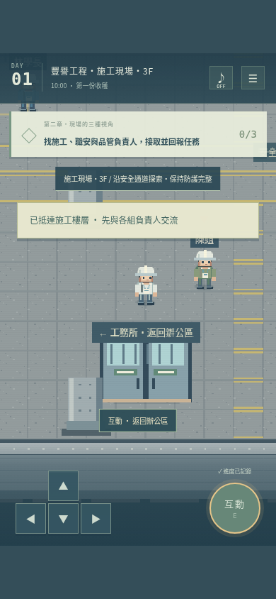

# 辦公區與施工現場串接

## 遊玩路線

1. 沿用既有辦公區進度，或從 HR 報到開始。
2. 完成規劃室三項調查並向林以安回報。
3. 到入口大廳南側的雙扇門，靠近後按 E / 空白鍵 / 手機互動鍵，閱讀帶領說明後進入施工現場。
4. 施工現場的林學長、陳姐、許學姐分別負責施工、職安、品管任務。接取後才會出現該組目標驚嘆號。
5. 每組完成三個觀察點後，回到負責人身邊回報，取得工作紀錄。
6. 可隨時經工地南側「返回辦公區」通道往返，不丟失未完成任務。
7. 三組都回報後，返回 HR 找雅涵交流，收下第一天實習紀念章。

## 共用資料

兩個區域在同一主遊戲內切換，不再要求另開 legacy.html。共用姓名、裝備、背包、辦公任務、現場任務與當前位置。舊版辦公區 `fengyu-office-v2` 存檔會補入缺少的現場欄位，保留原有進度；舊版獨立施工存檔 `fengyu-site-v1` 不會被覆寫。

場景切換會銷毀舊地圖的碰撞群組與圖層，再建立目的區域的碰撞與角色，不把兩張地圖重疊。靜態資源與 `/zoy/` 發布路徑沿用原設定。

## 現場內容

- 施工：鋼筋、模板、支撐系統的觀察。
- 職安：開口防護異常、滅火器與安全通道。異常以護欄外觀察、標記及通報處理，不鼓勵玩家自行拆修。
- 品管：查驗表、管材批次與現場核定圖說核對。缺少證明的材料維持管制，回報負責人。
- 任務沒有問答分數，透過走訪、多頁觀察及回報推進。

## 驗證

正式建置成功，完整瀏覽器套件 4 項通過（2.8 分鐘）；調整通道落點後，舊存檔遷移與雙向通道測試再跑 1 項通過。

瀏覽器測試包含從報到出發、辦公規劃任務、進入工地、工地重新讀檔、三組九項觀察與回報、返回 HR 完成第一天，再次往返兩區域及重新讀檔。另有手機方向控制與牆面碰撞、舊版入口、既有辦公存檔升級的獨立測試。

手機測試使用 Chromium 模擬視窗與指標輸入，尚未代表實體 Safari / Android 驗證。建置與本地測試成功不代表 GitHub Pages 已完成遠端部署。

