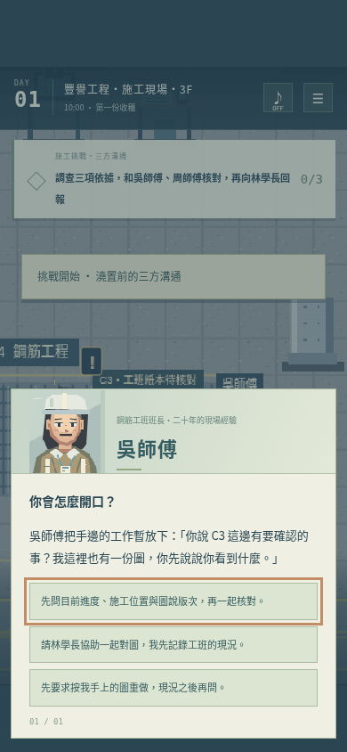
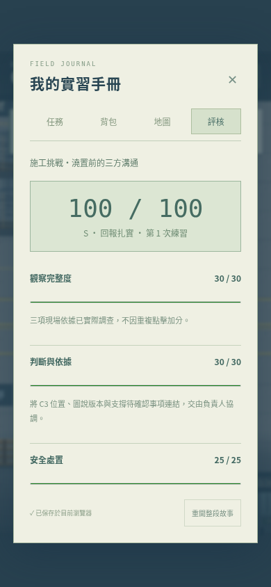

# 施工挑戰：澆置前的三方溝通

這是第一個含工班分支對話與實際評核的挑戰。既有辦公室、施工／職安／品管探索任務繼續保留；其他職種目前尚未各自加入進階評分挑戰。

## 怎麼玩

1. 完成報到與規劃回報，從辦公區南側進入施工現場。
2. 先找林學長接取施工觀察任務。已完成原任務的舊存檔也可以直接接新挑戰。
3. 在鋼筋區旁找 **吳師傅**，選「接下施工溝通挑戰」。不接受前，不會記錄挑戰依據。
4. 查看現場圖說、C3 構件標示與支撐架的待確認便條，順序不限。
5. 與吳師傅確認紙本版本及工作階段，再找模板區的 **周師傅** 確認支撐交接。**小許** 可提供文件傳遞的額外說明。
6. 向林學長整理回報。可以先補查、如實提交部分資料，或選擇缺少依據的結論；工程師會有不同回應。
7. 正式交件後，右上手冊的「評核」顯示本次分數、表現等級、逐項原因與改善建議。
8. 回吳師傅身邊重新挑戰，只重設挑戰本身，保留原任務、背包及最近五次結果。

## 角色與分支

- 吳師傅：鋼筋班長，有自己的工作現況。先詢問、請工程師一起核對、直接要求重做，會得到不同反應。未詢問便先下結論時，後續可回來補問。
- 周師傅：模板班長，面對人力與工期安排。維持待確認、一起核對計畫、建議先照舊施工，會改變交接對話與現場標示。錯誤建議不會在遊戲中實際放行作業，仍可改正。
- 小許：材料與文件聯絡員，補充紙本交接與舊版管理的背景，不因多聊一次就加分。
- 林學長：協調與回報窗口，完整回報、如實提出缺口、沒有依據就說可照舊，對應不同結果。

新增角色有不同的像素配色、工作服、配件與對話立繪。普通工班角色不增加紅色三角，原本四位主要任務 NPC 的規則維持不變。

## 配分

| 評核項目 | 滿分 | 得分依據 |
| --- | ---: | --- |
| 觀察完整度 | 30 | 三項實際走訪的現場依據，每項 10 分，只記一次 |
| 判斷與依據 | 30 | 將位置、版次、工作現況及待決事項連結回報；部分回報按已確認資訊給分 |
| 安全處置 | 25 | 先維持受影響工項待確認，再由負責人核對；先建議照舊、後修正可恢復至 20 分 |
| 溝通與回報 | 15 | 詢問現況或尋求工程師協助，並交代事實與待確認項目；先直接下結論、後補問保留 2 分扣分 |

不以速度、背誦名詞或人格傾向計分。尋求專業人員協助是完整得分的有效路線。S / A / B / C 是本次回報表現，不是角色人格或職涯分類。

歷史結果在交件時保存，不會在事後重點物件時改分。已完成結果不可重複提交刷分，物品也不會因重試重複獲得。新一次練習重設依據與對話，保留先前結果。

## 已驗證的結果

正式建置通過。新挑戰 4 項測試通過；品管 NPC 與查驗台拉開位置後，原有遊戲流程 4 項回歸測試也通過。最後再次跑完滿分路線、保存對話與結果截圖。

- 完整觀察、詢問、計畫核對與完整回報：**100 / 100**，四項為 30、30、25、15。
- 先要求重做、建議照舊，後來補問及修正，再完整回報：**93 / 100**，四項為 30、30、20、13，顯示扣 5 分及扣 2 分的具體原因。
- 未調查、未確認安全處置，僅直接下結論並交件的測試路線：**4 / 100**，明列缺少的三項依據與回報問題。
- E／空白鍵不能略過選項節點。資訊不齊時，完整核對回報選項禁用，但仍可先補查或如實回報缺口。
- 已驗證對話選擇、現場標示、存檔讀取、重試、原任務保留，以及異常分數資料拒絕載入。

新挑戰瀏覽器案例使用已完成原任務的存檔測試升級後的遊玩，不直接注入挑戰分數或對話結果；角色仍以實際鍵盤走到所有 NPC 與物件。原有測試仍從角色建立開始走完整個第一天流程。

## 畫面

評核頁可以向下捲動查看四項原因、工程師回饋及歷史紀錄。手機測試為 Chromium 模擬畫面，尚未代表真機 Safari／Android 驗證。
