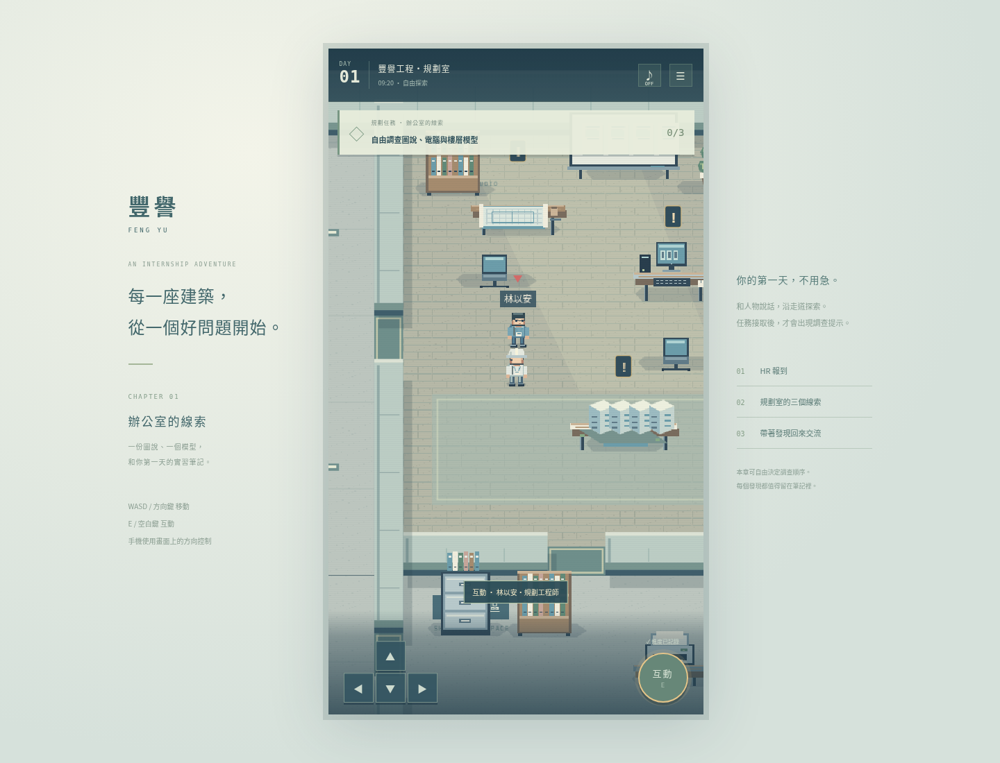
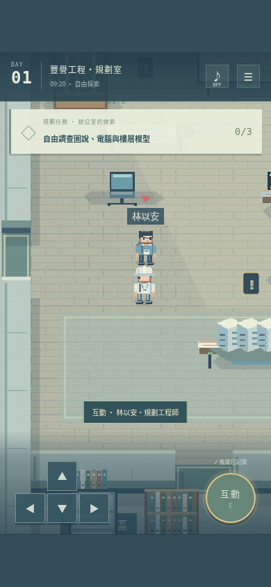
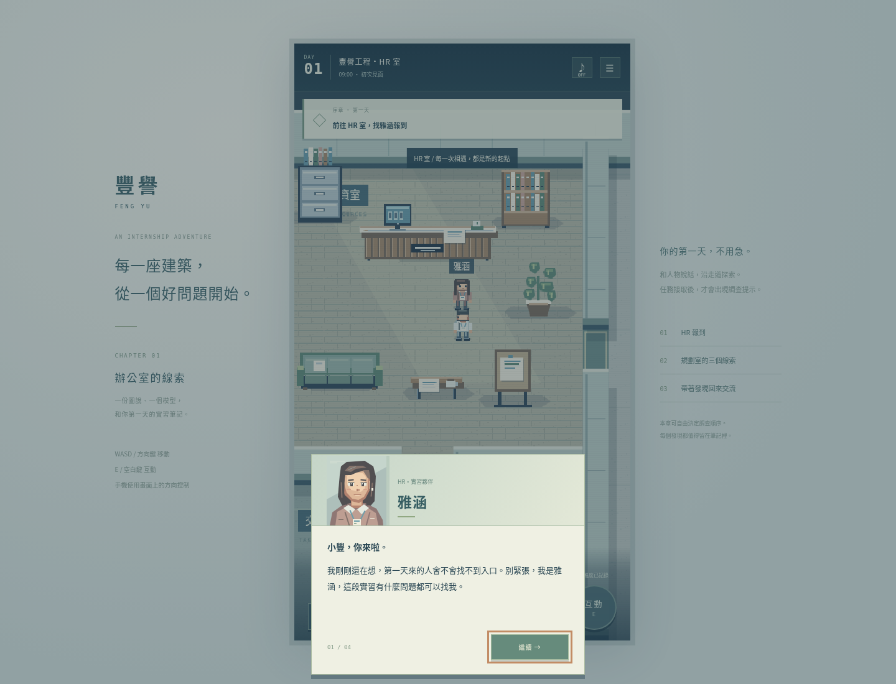

# 第一章驗收：辦公室的線索

本次在 `feat/office-rpg-day-one` 開發，不修改或部署 main。舊版保留為獨立 `legacy.html` 入口。

`CHROMIUM_PATH=/usr/bin/chromium npm test`：正式建置通過，3 項瀏覽器測試通過（50.4 秒）。

## 已驗證的流程

使用 Node 24.19.0、Phaser Canvas、Linux 系統 Chromium 與 Playwright，在普通靜態伺服器上測試根目錄正式產物，而不是只測 Vite 開發伺服器。

1. 從標題畫面建立實習生，沿實際通道走到 HR 室，完成多頁報到對話。未結束報到對話前，不提前取得裝備。
2. 報到後取得識別證、安全帽、實習手冊，角色外觀換上安全帽。
3. 尚未接取規劃任務時，只有規劃 NPC 的紅色三角，設備不出現驚嘆號；提前查看設備不記為任務進度。
4. NPC 對話可選稍後再來，不會默默接取。正式接取後，三個未調查設備才出現驚嘆號。
5. 玩家實際走訪模型、電腦、圖說，以不同於資料排列的順序調查。未操作時記錄按鈕禁用；中途關閉調查不取得進度。
6. 實際旋轉模型、打開核定紀錄、切換圖說，再記入筆記。已調查標記移除。
7. 三項完成只到「等待回報」，尚未取得獎勵；再次與規劃 NPC 對話後才完成任務。
8. 回 HR 完成本章交流與見習章，背包可查看所得物品，地圖可查看位置；重新載入後可繼續已保存的進度。
9. 手機 390×844 視窗中的遊戲畫框維持 9:16，實際按住方向鈕移動；沿中央走道撞向分隔牆，確認不能穿越。
10. 手冊開啟時停止移動；可開關聲音、取消重新開始，或確認後重新建立角色。
11. 未報到先與規劃 NPC 說話，只會被引導到 HR；鍵盤 E 結束對話不會立刻重開；舊版施工樓層仍可啟動。

測試只讀取遊戲狀態及碰撞幾何來計算路線，再送出真正鍵盤事件；沒有傳送玩家或把任務直接設為完成。完整流程檢查頁面錯誤與 HTTP 資源失敗。

## 畫面

桌面直式遊戲框：

手機 9:16 與觸控介面：

HR 對話與像素立繪：

## 邊界

- 第一階段交付辦公區與完整規劃任務，不宣稱施工、職安、品管三個新場景已完成。
- 施工通道明確標示後續階段，不會傳送至假場景。
- 全部素材為自製像素圖集與程序繪圖，沒有單張背景替代地圖。仍可進一步精修角色表情、動作與設備動畫。
- 環境音為可選的合成聲音，不是現場錄音。預設關閉。
- 測試使用 Chromium 模擬手機畫面及指標輸入，尚未在實體 iOS Safari / Android 裝置驗證。
- GitHub Actions 工作流程已加入，但本地測試成功不代表 GitHub 遠端 CI 或正式 Pages 已發布。本分支不覆蓋正式站。
