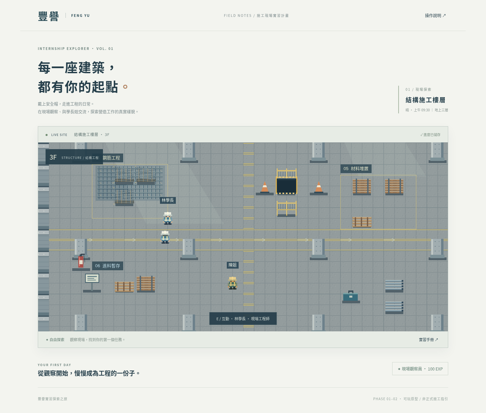
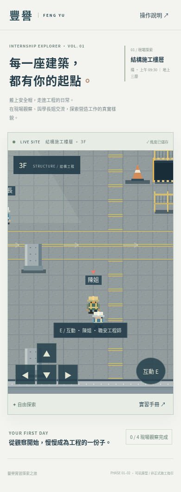

# 驗證紀錄

2026-10-19，Node 24.19.0，Linux 系統 Chromium，Playwright。

- `npm ci --cache /tmp/zoy-npm-cache`：通過，鎖檔可重現安裝。
- `npm run build`：TypeScript 與 Vite 正式建置通過。Phaser 主套件產物約 1.23 MB（gzip 約 343 KB），Vite 會提示 bundle 大小。
- `CHROMIUM_PATH=/usr/bin/chromium npm test`：2 項通過。
  - 桌面 1440×1100：命名、鍵盤移動、沿實際通道探索、棧板碰撞、四項問答、回報領獎、重新載入保存、無 JavaScript runtime error。
  - 手機視窗 390×844：命名、按住方向按鈕移動、互動與說明介面、頁面無橫向溢出。
- 下列為該次測試擷取畫面，非概念圖。

測試以 Linux Chromium 模擬手機視窗及指標輸入，尚未在實體 Android / iPhone、Safari 或 Firefox 驗證。不宣稱 GitHub Pages 已上線；仍需 GitHub 端部署成功。

第一階段基礎流程可玩。第二階段已提供模組化施工樓層、物件配置、碰撞及遮擋，但美術仍為自製原型，並未達成最終精緻素材包。未完成項目與素材缺件見 README。

## 靜態發布修正

首頁原先直接引用 `/src/main.ts`，無法由 GitHub Pages 執行，造成只有 HTML 文字。現將開發入口移至 `client/index.html`，根目錄保存建置後的 HTML、CSS、JavaScript 與 `.nojekyll`。建置時自動更新根目錄；Playwright 改為透過普通靜態伺服器測試根目錄產物。渲染器固定使用 Canvas，避免無 GPU 環境重載時的 WebGL framebuffer 錯誤。

修正後：普通靜態伺服器上的桌面與手機 Playwright 測試 2 項通過；開發模式也確認 Canvas 初始化且沒有 JavaScript 錯誤或資源 HTTP 失敗。
